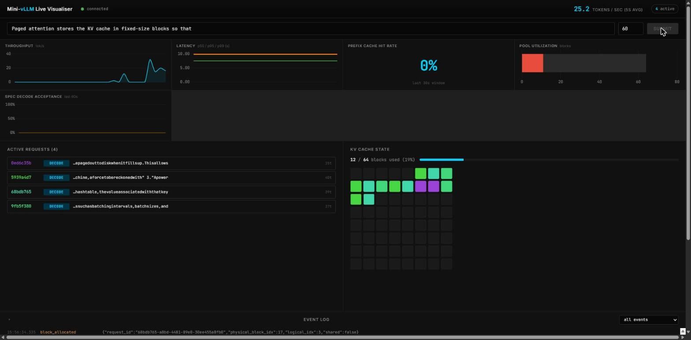
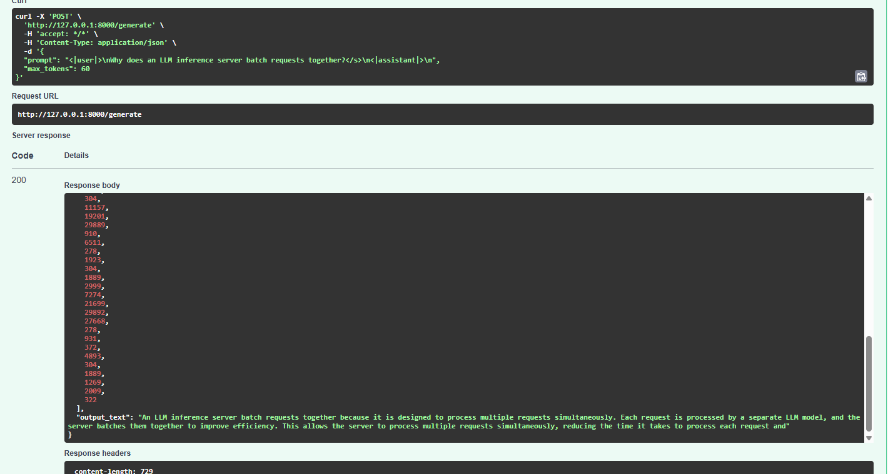
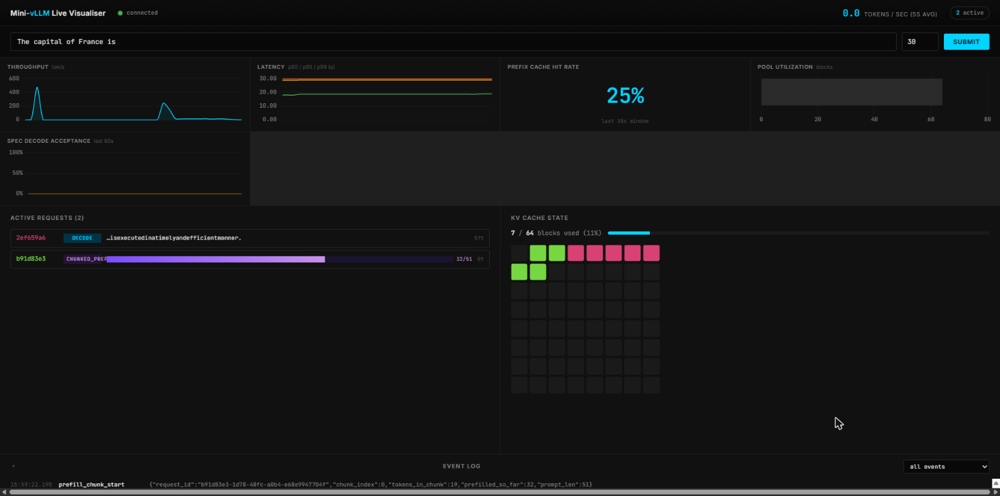
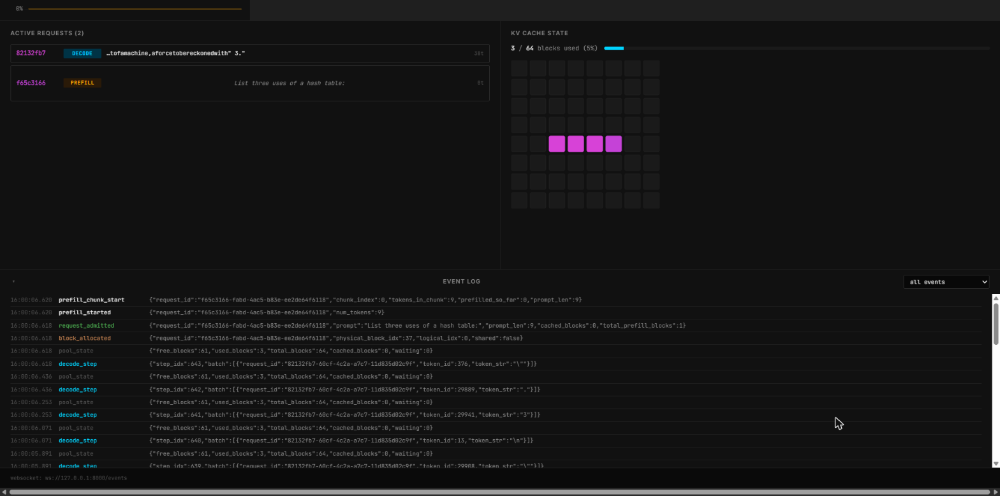

# Mini-vLLM

Mini-vLLM is an educational reimplementation of the core ideas in vLLM,
written from scratch around TinyLlama-1.1B-Chat. It covers continuous
batching, a paged KV cache (PagedAttention), prefix caching, chunked prefill
and token streaming. It also includes a live WebSocket visualiser that shows
each scheduler decision and cache block as it happens. Every layer of the
engine is checked against Hugging Face `transformers` with parity tests.

The goal is to make the internals of a modern inference server visible and
testable, so the code favours clarity over raw speed.

The repository also contains CARL (Coordinated Adaptive Runtime Learner), an
experimental online controller that tunes several serving settings together,
along with its evaluation suite. See
[CARL (research extension)](#carl-research-extension).

## In action

The screenshots below come from a local run of `uvicorn src.server.api:app`
serving TinyLlama-1.1B-Chat on CPU (`torch 2.12.0+cpu`, with no CUDA
available in that environment). The server used its default configuration:
FIFO scheduler, 64 KV blocks of 16 tokens, and speculative decoding and CARL
both switched off. Throughput numbers visible in the UI come from that CPU run
and are not benchmark results.


*The live visualiser with four concurrent requests in `DECODE`, all served by
the same batched decode step. Each request's KV blocks have their own colour
in the paged cache grid (12 of 64 blocks in use). The request previews run
words together because the visualiser joins SentencePiece tokens without
restoring spaces. This is a known display issue.*


*A `POST /generate` call made from the server's built-in FastAPI page
(`/docs`). It shows the chat-formatted prompt, the returned token IDs and the
decoded `output_text`: 60 tokens of unedited TinyLlama-1.1B output.*


*Prefix caching with chunked prefill. These requests share a system prompt,
so they reuse its first two 16-token KV blocks. Request `b91d83e3` therefore
starts prefill at token 32 of 51 (`prefilled_so_far: 32` in the event log)
while another request is decoding. The hit-rate panel is computed from
`prefix_cache_hits_total` and `prefix_cache_misses_total` on `/metrics`.*


*The `/events` WebSocket stream, showing admission, block allocation, prefill
and per-step decode events in the order the scheduler emits them, next to the
active request list and KV cache grid.*

## Getting started

### Requirements

- Python 3.11
- About 2.5 GB of disk for the TinyLlama weights, which are downloaded from
  the Hugging Face Hub on first run
- About 4 GB of RAM during inference
- Optional: an NVIDIA GPU. The engine uses CUDA when PyTorch can see a GPU
  and falls back to CPU otherwise. CPU works, but it is slower.

### Install

```bash
git clone https://github.com/vsvidhun06-blip/mini-vllm.git
cd mini-vllm
python -m venv .venv
source .venv/bin/activate          # Windows: .venv\Scripts\Activate.ps1
pip install -r requirements.txt --extra-index-url https://download.pytorch.org/whl/cu121
```

`requirements.txt` pins `torch==2.5.1+cu121`. That build is only published
on PyTorch's own wheel index, so a plain `pip install -r requirements.txt`
fails with `No matching distribution found for torch==2.5.1+cu121`. The
`--extra-index-url` flag above points pip at that index. On a CPU-only
machine, install a CPU build of PyTorch and then the remaining requirements.

### Run the tests

```bash
pytest tests/ -q
```

The suite has about 830 tests in `tests/test_engine` (HF parity, paged and
prefix caching, chunked prefill, speculative decoding, LoRA, CUDA graphs and
more), `test_server`, `test_carl`, `test_router` and `test_eval`. Tests that
need TinyLlama or a GPU are skipped when those aren't available. The engine
parity tests load the model repeatedly, which makes the full suite slow on
CPU. For a quick check, run:

```bash
pytest tests/test_server tests/test_carl -q
```

### Start the server

```bash
uvicorn src.server.api:app        # http://localhost:8000
```

Open `http://localhost:8000/`, type a prompt into the visualiser and press
**Submit**. The page streams the response through `POST /generate/stream`.
You can also send requests from `http://localhost:8000/docs` or with `curl`.
Sending several at once makes it easier to watch requests move through
`WAITING -> PREFILL -> DECODE -> DONE` and see the cache grid fill up for
each one.

Endpoints:

- `POST /generate` and `POST /generate/stream` (server-sent events)
- `WS /events`: scheduler and cache events for the visualiser
- `GET /metrics`: Prometheus metrics
- `GET /profiler`: rolling per-phase step timings and the current bottleneck
- `GET /tuning-log`: parameter changes made by the auto-tuner
- `POST /adapters`: registers synthetic LoRA adapters for routing demos
- `/carl/state`, `/carl/stats`, `/carl/log`, `/carl/config` and `/carl/reset`

Optional environment variables, read at startup:

| Variable | Effect |
|---|---|
| `CHUNK_SIZE` | Chunked-prefill token budget per step (default `256`) |
| `ENABLE_SLA_SCHEDULER` | Use the priority- and deadline-aware `SLAScheduler` instead of FIFO |
| `ENABLE_CARL` | Attach the CARL controller to the live scheduler (off by default) |
| `HF_HUB_OFFLINE=1` | Standard Hugging Face setting. Uses the cached model without network access |

## Architecture

```
    Prompt -> FastAPI -> ContinuousBatchScheduler
                              |
                              +-- LlamaModel (from-scratch)
                              |     |
                              |     +-- RoPE + GQA Attention
                              |     +-- SwiGLU MLP
                              |     +-- RMSNorm (fp32)
                              |
                              +-- PagedKVCache (block_size=16)
                              |
                              +-- EventBus -> WebSocket -> Visualiser
```

## Design decisions

[`docs/design.md`](docs/design.md) covers these in detail, and
[`docs/talking_points.md`](docs/talking_points.md) is a shorter Q&A summary.

- **HF parity as the correctness check.** Every engine layer has a parity
  test against `transformers` at `atol=1e-4`, covering the forward pass,
  cached generation, paged-cache generation and the scheduler.
- **Per-layer KV cache positions.** Each layer reads its own cache length
  before appending instead of relying on a shared counter. This fixed an
  off-by-one in cached generation during development.
- **Mixed prefill and decode batching.** Each step runs prefill for newly
  admitted requests one at a time, then a single batched decode pass over
  every request in `DECODE`. In steady state, steps are decode-only.
- **Paged cache layout.** K and V live in separate pools, stored layer-major
  with `block_size` before `num_kv_heads`, so SDPA can work on views without
  making strided copies. The module docstring in `src/engine/kv_cache.py`
  explains the layout.
- **Synchronous EventBus with a `loop.call_soon_threadsafe` bridge.** The
  scheduler emits events synchronously from worker threads. Each WebSocket
  subscriber owns an `asyncio.Queue`, so the bus itself has no dependency on
  asyncio.

## Observability (Prometheus and Grafana)

The server exposes Prometheus metrics at `/metrics`. The repository also
includes a Docker Compose stack with a pre-provisioned Prometheus datasource
and Grafana dashboard, so the dashboard is ready as soon as the containers
start, with no manual import.

```bash
uvicorn src.server.api:app --port 8000                       # 1. engine on the host
docker-compose -f docker-compose.observability.yml up        # 2. Prometheus + Grafana
# Grafana:    http://localhost:3000   (anonymous viewer; admin/admin to edit)
# Prometheus: http://localhost:9090
```

Prometheus scrapes `/metrics` every 5 seconds through `host.docker.internal`,
which is mapped to the host gateway so the setup works with both Docker
Desktop and Linux. The dashboard in `grafana/dashboards/mini_vllm.json` has
nine panels:

- **TTFT** P50/P95/P99 and **TPOT** P50/P95/P99 time series
- **Queue depth** (waiting requests) over time
- **Cache utilisation** gauge (% of KV blocks in use)
- **Decode batch-size** histogram (heatmap over time)
- **Requests/sec** throughput
- **CUDA graph hit rate** (graph-replayed vs eager decode forwards)
- **Bottleneck over time** and **bottleneck distribution** (from the step profiler)

The panels are related to each other. Cache utilisation and queue depth drive
TTFT, and batch size together with CUDA graph hit rate explain TPOT.
[`docs/observability.md`](docs/observability.md) has the full metric
reference and explains what each metric says about inference quality.

## Benchmarks

### v0.1 (CPU)

TinyLlama-1.1B-Chat in fp32 on CPU, with four concurrent requests generating
32 tokens each. Speedups are relative to a sequential `generate()` loop over
the same prompts.

| Configuration | Time | Speedup | Notes |
|---|---|---|---|
| Solo (sequential) | 16.32s | 1.00x | baseline |
| Continuous batching, ample blocks | 5.26s | 3.10x | scheduler parity test |
| + Paged KV cache, ample blocks | 5.35s | 3.27x | paged overhead amortised |
| Paged + tight blocks (6) | 8.78s | 1.79x | admission control under back-pressure |

The last row shows admission control at work. With only 6 cache blocks, the
scheduler has to queue some requests until earlier ones free their blocks.
Total wall time goes up, but the output still passes the parity test
(`test_paged_scheduler_with_tight_blocks_still_parity`).

**Provenance.** These are historical v0.1 measurements, and the raw log for
this table is not in the repository. The speedups in rows 3 and 4 don't equal
16.32 s divided by the listed time (that would give ≈3.05× and ≈1.86×), which
suggests they were computed against separate baseline runs. Later GPU
measurements (RTX 4060 Laptop, fp32) are kept as raw logs in
[`docs/benchmarks/`](docs/benchmarks/), for example
[`v0.2_gpu.txt`](docs/benchmarks/v0.2_gpu.txt).

### Comparison with vLLM

Mini-vLLM is meant to make the ideas inside
[vLLM](https://github.com/vllm-project/vllm) easy to see and verify, and it
makes no attempt to match vLLM's performance.
[`scripts/benchmark_vs_vllm.py`](scripts/benchmark_vs_vllm.py) runs both
engines on identical TinyLlama workloads.

As you would expect from a teaching engine compared with a production system,
mini-vLLM is roughly an order of magnitude slower on per-token latency (TPOT),
and the throughput gap grows with batch size. Each part of the gap maps to a
production technique that the v1 engine leaves out to keep the code readable:

- **TPOT.** vLLM replays a captured CUDA graph (one launch per step).
  Mini-vLLM dispatches eager PyTorch operations, which means hundreds of
  kernel launches per step.
- **Throughput at batch=8.** vLLM's C++ scheduler and paged-attention CUDA
  kernels keep the GPU saturated. Mini-vLLM's Python `step()` loop adds host
  overhead that grows with batch size.
- **TTFT.** vLLM's async engine overlaps tokenisation and scheduling.
  Mini-vLLM admits requests synchronously on one thread.
- **fp32 for parity.** Mini-vLLM runs in fp32 to match HF outputs at
  `atol=1e-4`, while vLLM runs in fp16. That roughly doubles the memory
  traffic in a decode step that is already bandwidth-bound.

[`docs/vllm_comparison.md`](docs/vllm_comparison.md) covers the methodology,
a component-by-component breakdown and an analysis of the gap. On machines
where vLLM can't be installed, the benchmark script still runs and reports
mini-vLLM results only.

## Speculative decoding

Speculative decoding is implemented but off by default in the server
(`enable_spec_decode=False`). At the acceptance rates measured on TinyLlama,
enabling it would slow down every request.

### v0.3: infrastructure

- The speculative decoding infrastructure is in place: drafting,
  verification, KV cache rewind, scheduler integration, metrics and a
  visualiser panel.
- The algorithm produces byte-identical output to greedy decoding
  (`test_spec_decode_matches_greedy`).
- Self-speculation with early exit on TinyLlama reaches only about 1%
  acceptance, while about 30% or more is needed to break even with K=4.
  TinyLlama wasn't trained for early exit (it has no LayerSkip-style
  objective), so intermediate-layer residuals don't decode well through the
  final `lm_head`. A probe script found that even layer 21 of 22 reaches only
  52% acceptance, where 95% or more would be needed.
- The v0.3 plan was to add a trained draft mechanism in v0.4 (a smaller draft
  model, an EAGLE-style draft head or a LayerSkip fine-tune). The v0.4 section
  below records what happened.

### v0.4: tuning experiments

This was a time-boxed attempt to get a net speedup from the v0.3
implementation. Two phases were planned. The second turned out to be
infeasible because of tokenizer compatibility.

**Phase 1: configuration sweep.** K and `exit_layer` were made configurable
on the scheduler, and three combinations were compared against plain
decoding on the continuation prompt:

| config                        | speedup | acceptance |
|-------------------------------|--------:|-----------:|
| Earlier default (K=4, exit=8) |   0.46x |       1.1% |
| (a) K=2, exit=8               |   0.65x |       2.1% |
| (b) K=4, exit=18              |   0.59x |      28.3% |
| (c) K=2, exit=18              | **0.78x** | **37.5%** |

K=2 beats K=4 at both depths. Acceptance is measured per position and errors
compound, so later draft positions are less likely to match. Drafting fewer
positions raises the acceptance rate and wastes less work per round.
Acceptance rises with depth (1.1%, then 28.3%, then 37.5%) but never meets
the breakeven condition `α > exit_layer/22`, which needs 36% at exit=8 and
82% at exit=18. The best configuration is still slower than plain decoding.

**Phase 2: a separate draft model.** This was ruled out before any code was
written. The plan needed a small public Llama model that uses TinyLlama's
SentencePiece tokenizer, and none exists. SmolLM-135M, Qwen-0.5B and similar
models use GPT-2-family BPE tokenizers, which are incompatible. Speculative
decoding across tokenizers needs per-token remapping, which usually breaks the
byte-identical parity guarantee and would be a research project of its own.

**Outcome.** A net speedup needs a trained draft mechanism that shares the
base model's tokenizer, for example:

- a LayerSkip-style fine-tune of TinyLlama, which adds an early-exit training
  signal to raise intermediate-layer acceptance into a useful range
- an EAGLE-style draft head, a small trained adapter that predicts future
  positions from the base model's hidden states
- Medusa-style multi-head decoding, with several `lm_head`s predicting N
  positions ahead

All three require training. The v0.3 infrastructure (KV rewind, scheduler
integration, metrics and dashboard) is correct and can be reused with any of
them. Because `exit_layer` is now configurable, `enable_spec_decode=True` can
be tuned without code changes, and a trained draft head can be added behind
the same interface.

## CARL (research extension)

`src/carl/` implements a contextual-bandit controller (LinUCB or Thompson
sampling) that picks scheduler, chunking, speculation, routing and eviction
settings together for each workload regime. It is off by default in the live
server. Setting `ENABLE_CARL=1` turns it on, and in the server only the
scheduler settings are connected to it.

Most of the CARL evaluation is a control-loop simulation driven by an
analytical cost model, so its numbers are not GPU measurements. The current
recorded conclusion is that the repaired CARL ties the rule-only baseline.
[`docs/eval/README.md`](docs/eval/README.md),
[`docs/paper/RESULTS_DECISION.md`](docs/paper/RESULTS_DECISION.md) and
[`docs/eval/CARL_REPAIR_STATUS.md`](docs/eval/CARL_REPAIR_STATUS.md) cover the
methodology, the hardware behind each result and the open items.

## Repository layout

```
mini-vllm/
├── src/
│   ├── engine/                 # model, attention, paged KV cache, radix/prefix
│   │                           # cache, schedulers (FIFO + SLA), spec decode,
│   │                           # LoRA, CUDA graphs, profiler, auto-tuner, ...
│   ├── server/
│   │   ├── api.py              # FastAPI: /generate, /generate/stream, WS /events, ...
│   │   └── metrics.py          # Prometheus metrics (EventBus subscriber)
│   ├── visualiser/
│   │   └── index.html          # single-file SPA, served at GET /
│   ├── router/                 # request classifier + model router
│   ├── carl/                   # CARL controller, bandits, reward, /carl API
│   └── eval/                   # simulation engine model + provenance helpers
├── tests/                      # test_engine, test_server, test_carl, test_router, test_eval
├── scripts/                    # benchmarks (benchmark_*.py, bench_*.py) and scripts/eval/
├── docs/
│   ├── design.md, talking_points.md, vllm_comparison.md, observability.md
│   ├── benchmarks/             # raw benchmark logs
│   ├── eval/                   # CARL evaluation results, preregistrations, figures
│   └── screenshots/            # README images
├── grafana/, observability/, docker-compose.observability.yml
├── paper/                      # LaTeX sources
└── requirements.txt
```

## Author

Vidhun Vijayakumar Suja
MSc Software Engineering, Heriot-Watt Edinburgh (graduating June 2026)
Dissertation: *WEAKEST Execution Visualiser* (abstract submitted to CONCUR 2026)

- GitHub: <https://github.com/vsvidhun06-blip>
- Portfolio: <https://vsvidhun06-blip.github.io/>
